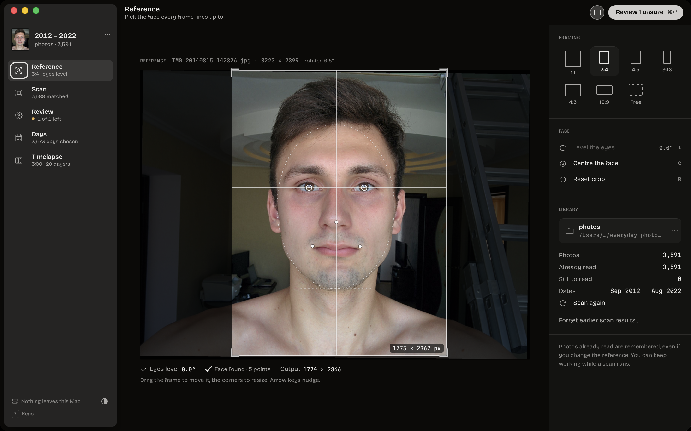
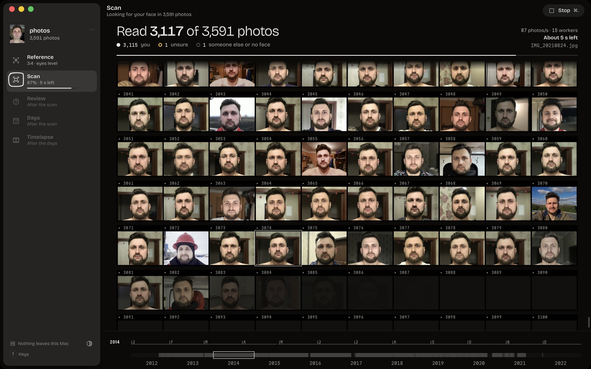
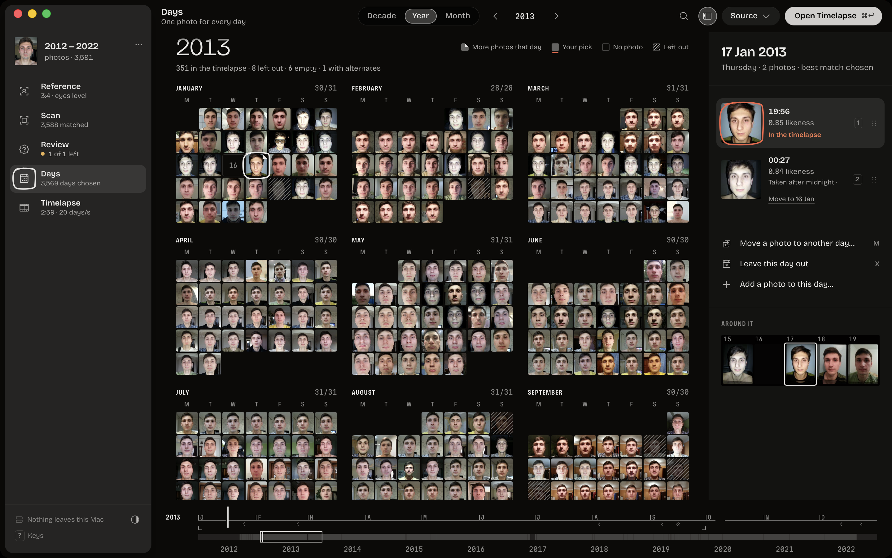
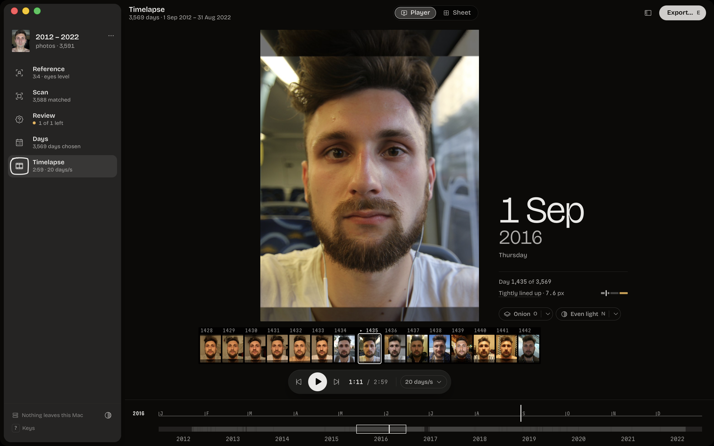
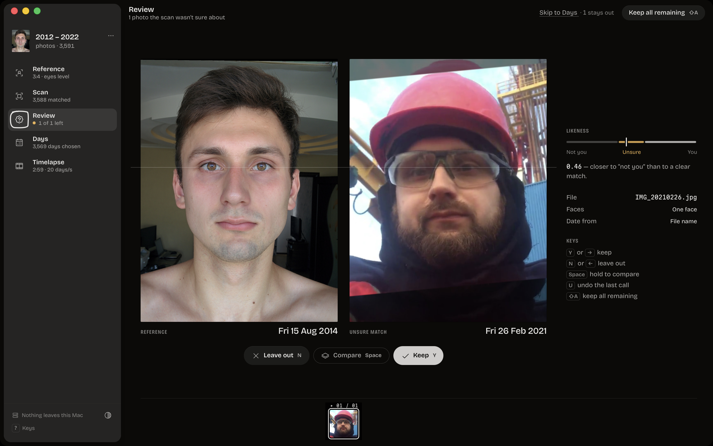
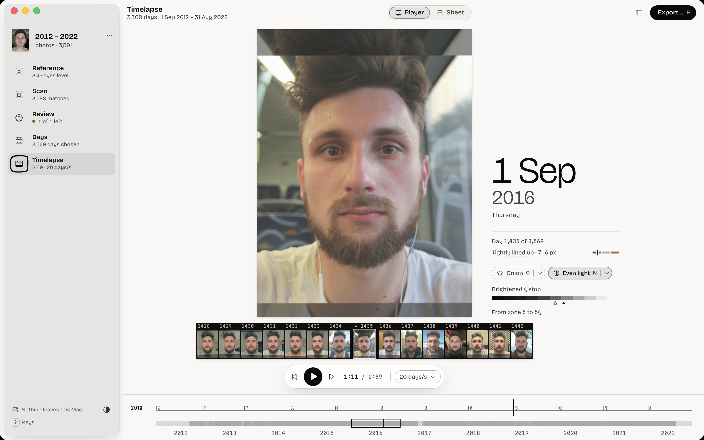
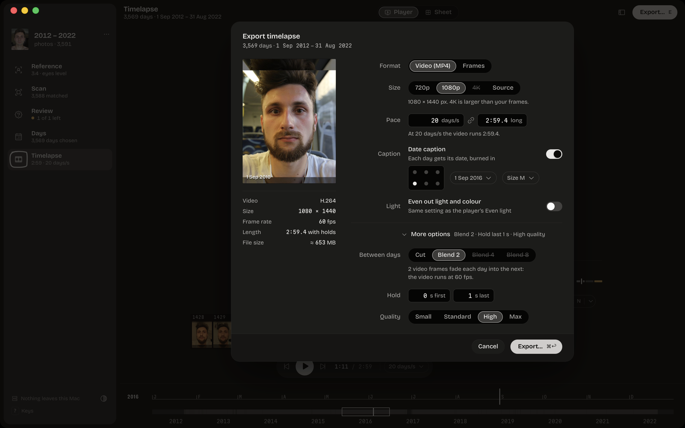

# FaceTimelapse

[](https://github.com/Gingerman960/face-timelapse/actions/workflows/ci.yml)
[](./LICENSE)

FaceTimelapse is a desktop app for people who have taken a selfie (nearly) every day for years. Pick one reference photo and a folder of thousands of photos. The app finds you in every one of them, keeps one photo per calendar day, aligns your face so the eyes, nose and mouth land on the same pixels in every frame, and plays the result back as a timelapse before it exports an MP4 or a folder of aligned frames. Everything runs on your machine: there are no accounts, no uploads and no network access. The app is built with Tauri 2: a pure-Rust engine (face detection, recognition, alignment, H.264 encoding) under a React UI.

## Features

- **Finds one person in a camera roll.** SFace face-recognition embeddings on YuNet-detected faces pick you out of group photos, and in a multi-face photo the app aligns the face that matched, not the largest one. Scores keep the familiar 0–1 scale: confident matches flow straight through, and unsure ones (sunglasses, a hard hat) go to review.
- **Incremental scans.** Each photo is analyzed once and cached, independently of the reference. Changing the reference photo or its crop re-matches the whole library in memory without rescanning, and a rescan of an unchanged 3,600-photo library takes about 35 ms. Cancelled scans resume where they stopped.
- **Keyboard review.** Unsure matches appear one at a time next to the reference, already aligned to it: `Y` keeps a photo, `N` leaves it out, `U` / ⌘Z undoes, Space compares, ⇧A keeps the rest. Wrongly rejected photos can be rescued from the library view.
- **One photo per day.** A calendar where every day cell is its own photo. The best match is picked automatically; you can choose an alternate, drag a photo to another day (pointer or keyboard), add a photo to an empty day, leave a day out, or move an after-midnight selfie back to the day it belongs to. Dates come from EXIF, then from file names such as `IMG_20140815_142326.jpg`, then from the file time, and the app shows which source it used.
- **Stable alignment.** The face is aligned with a similarity Procrustes fit on five landmarks. The landmarks are refined by re-detecting each face four times (two sizes, plain and mirrored), which halves frame-to-frame eye jitter. Per-frame nudges (offset, scale, rotation) re-render live. Output presets are 720p, 1080p and 4K, or the crop's own pixel size, and the area outside the photo can be a dimmed, blurred or black backdrop with a feathered edge.
- **In-app player.** Play, scrub and step through the aligned timelapse at the export pace, with a decade ribbon (year and day ticks) as the scrubber, a crossfade preview, an onion skin (previous frame or the reference, adjustable opacity, difference blend) and anchor-point overlays to check the alignment. A contact-sheet view flags frames whose fit is poor.
- **Even light.** Optional exposure and white-balance normalization matches each frame's face region to the reference (Oklab statistics, adjustable strength, A/B toggle). It is applied on read, so toggling it never re-renders the frames.
- **Video export.** Coupled fps and duration controls, crossfades between days, date captions (format, position, size), first/last-frame holds, resolution and quality presets. Encoding uses Apple VideoToolbox (hardware) on macOS and openh264 elsewhere, with an automatic fallback, and writes a fast-start, BT.709-tagged MP4. Frames can also be exported as PNG or JPEG; existing files are never overwritten unless you ask.
- **Drag and drop.** Drop a photo on the window to make it the reference, or a folder to make it the library.
- **Session restore.** The app reopens where you left off: reference, crop, folder, review decisions, day picks, aligned frames and export settings, plus recent photos and folders.
- **Every long job can be cancelled.** Scan, align and export show progress, throughput and time left; cancelling keeps the work done so far, and a cancelled video leaves no half-written file behind.
- **Private by construction.** The app has no network client, no telemetry and no remote content; the face models and fonts ship inside the app.

## Screenshots

| | |
|:---:|:---:|
| **Reference**: crop editor with the alignment template | **Scan**: live contact sheet while the library is read |
|  |  |
| **Days**: a calendar of faces, one photo per day | **Timelapse**: player with filmstrip and decade ribbon |
|  |  |
| **Review**: an unsure match next to the reference, on one eye line | **Light theme**: the same player on the light table |
|  |  |

### Export



**Export…** (`E` in the Timelapse screen) opens a sheet with a preview of the current frame and its caption. Choose Video (MP4) or Frames, the size, the pace (days per second and video length are linked; edit either one), crossfades between days, holds, quality and the date caption. The footer shows the resulting codec, size, duration and an estimated file size. While the video encodes, the sheet shows the frame being encoded and the time left, and **Show in Finder** appears when it is done.

See [`assets/screenshots/README.md`](./assets/screenshots/README.md) for how these images are captured.

## How it works

```
Reference ──► Scan ──────────────────────► Review ──► Days ──────► Align ─────────────► Timelapse ──► Export
crop + face   walk, date, detect, embed,    unsure     one photo   refine landmarks,     player,       H.264 MP4
              cache, match vs reference     matches    per day     Procrustes, warp      onion skin    or PNG/JPEG
```

1. **Walk and date.** The folder is walked recursively (`.jpg .jpeg .png .tif .tiff .webp`; HEIC is counted and reported as unsupported). The capture date comes from EXIF `DateTimeOriginal`, then `DateTimeDigitized`, then the file name, then EXIF `DateTime`, then the file time, all as naive local times.
2. **Detect.** Each photo is decoded once (EXIF orientation applied, JPEG DCT-scaled to about 640 px) and YuNet finds up to three faces with five landmarks each. On the 3,591-photo reference library, the detector found a face in **99.97 %** of the photos; the only miss is an all-black frame.
3. **Recognize and match.** SFace turns each face into a 128-d embedding. A face matches when its cosine similarity to the reference passes OpenCV's published threshold (0.363), mapped onto the 0–1 score scale (≥ 0.60 confirmed, ≥ 0.40 unsure). On the reference library: 3,588 confirmed, 2 unsure (sunglasses, safety goggles), no false rejects, and no other person above 0.29.
4. **Cache.** Faces, landmarks, embeddings and dates are cached per photo, keyed by path, size and modification time, so matching against a new reference or crop is an in-memory pass (0.2 ms for 3,600 photos; a crop change including re-detection takes about 130 ms).
5. **Align.** The matched face's five landmarks are refined, then a similarity Procrustes fit (translation, rotation, uniform scale) maps them onto the reference landmarks at the output size. Eye jitter across frames is **about 2 % of the inter-pupillary distance** (4.1 % without refinement). Frames are rendered once, kept as JPEG masters keyed by a render fingerprint, and reused across restarts.
6. **Look and encode.** The optional light correction is a per-frame 3D LUT built from Oklab statistics of the face region. The video encoder letterboxes, crossfades and captions frames in Y′CbCr, encodes H.264 High profile, and muxes a moov-first MP4 without a second pass.

Measured on an Apple M3 Max (16 cores), release build, with the 3,591-photo library (8–12 MP JPEGs, 7.9 GB). Sources: [`crates/face-engine/BENCHMARKS.md`](./crates/face-engine/BENCHMARKS.md), [`crates/timelapse-video/README.md`](./crates/timelapse-video/README.md), [`docs/rewrite/INTEGRATION-NOTES.md`](./docs/rewrite/INTEGRATION-NOTES.md).

| Stage | Result |
|---|---|
| Full scan, no cache | **≈ 170 photos/s** (168 photos/s: 3,591 photos in 21.4 s) |
| Rescan with a valid cache | 74,000–108,000 photos/s (≈ 35 ms for the library) |
| Align, 1460×1080 masters with landmark refinement | 93 frames/s |
| Video, 300 real 12 MP photos → 1440×1080, crossfade + captions | **≈ 350 fps** with VideoToolbox (2.6 s), 190 fps with openh264 |
| Video, frames already at 1080×1080, captions on | 545 fps VideoToolbox, 346 fps openh264 |
| Peak memory, full scan + align of 3,577 days | 0.98 GB (backend) |
| Cold start of the release app to an interactive window | ≈ 0.4 s |

Face models run on [tract](https://github.com/sonos/tract), a pure-Rust ONNX runtime, so the app needs no native ML runtime, downloads nothing at build time and builds the same way on macOS, Windows and Linux. The binding design documents are in [`docs/rewrite/`](./docs/rewrite/): [`ARCHITECTURE.md`](./docs/rewrite/ARCHITECTURE.md) (IPC contract, algorithms, budgets), [`DESIGN.md`](./docs/rewrite/DESIGN.md) (the "darkroom / light table" design system), [`PRODUCT.md`](./docs/rewrite/PRODUCT.md) and [`LEGACY-SPEC.md`](./docs/rewrite/LEGACY-SPEC.md) (the behaviour of the Electron app this replaced).

## Install and run

Release bundles for macOS (Apple silicon and Intel, macOS 13 or later), Windows (NSIS installer) and Linux (AppImage, .deb) are published on [GitHub Releases](https://github.com/Gingerman960/face-timelapse/releases). To run from source:

**Prerequisites**

- Rust via [rustup](https://rustup.rs); `rust-toolchain.toml` pins the toolchain (1.99.1) and rustup installs it on first use
- Node.js 24 LTS (22.22 or later also works) with npm
- The platform's Tauri prerequisites: Xcode Command Line Tools on macOS; MSVC Build Tools and WebView2 on Windows; WebKitGTK 4.1 and friends on Linux. See [docs/BUILD.md](./docs/BUILD.md#prerequisites).

```bash
git clone https://github.com/Gingerman960/face-timelapse.git
cd face-timelapse
scripts/fetch-models.sh        # YuNet + SFace ONNX models into models/ (SHA-256 checked, idempotent)
npm --prefix ui ci             # UI dependencies, including the Tauri CLI
npm --prefix ui run app:dev    # build and launch the desktop app with hot reload
```

`app:dev` starts Vite on port 1420, compiles the Rust app in debug mode and opens the window. The first build compiles the whole dependency tree and takes a few minutes. On Windows, run `scripts/fetch-models.sh` from Git Bash.

### UI only, in a browser

```bash
npm --prefix ui run dev        # then open http://localhost:1420
```

Outside the Tauri window the UI installs an in-memory fake backend that implements every command of the IPC contract over a synthetic 3,600-photo, ten-year library (no real photos). URL parameters select a starting point: `?mock=fresh|ready|scanned|reviewed|aligned` and `&speed=instant|fast|normal`, for example <http://localhost:1420/?mock=aligned&speed=fast>. `npm --prefix ui run dev:mock` forces the fake backend even inside the Tauri window (macOS/Linux shell syntax).

### Release build

```bash
npm --prefix ui run app:build  # → target/release/bundle/ (.app + .dmg, NSIS .exe, AppImage + .deb)
```

Builds are unsigned unless signing credentials are configured. [docs/BUILD.md](./docs/BUILD.md) covers bundles, code signing and notarization, the release workflow and troubleshooting.

The npm scripts `tauri`, `app:dev` and `app:build` in `ui/package.json` run the Tauri CLI (`@tauri-apps/cli` 2.12.4) from the repository root, so they work both from `ui/` (`npm run app:dev`) and from the root (`npm --prefix ui run app:dev`). Any other CLI command works the same way: `npm --prefix ui run tauri -- info`.

## Tests

| Layer | Command | What runs |
|---|---|---|
| Rust, all crates | `cargo test --workspace` | unit, synthetic-image, IPC mock and contract tests; real-photo tests skip unless `FT_PHOTOS_DIR` is set |
| Rust lint | `cargo fmt --all --check` and `cargo clippy --workspace --all-targets -- -D warnings` | |
| Dependencies | `cargo deny check` and `npm --prefix ui audit --omit=dev --audit-level=high` | RustSec advisories, licences and sources per [`deny.toml`](./deny.toml); needs [`cargo-deny`](https://github.com/EmbarkStudios/cargo-deny) |
| Rust coverage | `cargo llvm-cov --workspace --ignore-filename-regex '(src-tauri/src/(main\|lib)\.rs\|/benches/)' --summary-only` | needs [`cargo-llvm-cov`](https://github.com/taiki-e/cargo-llvm-cov) |
| Engine throughput gates | `cargo test -p face-engine --release --test real_scan -- --ignored --nocapture` | needs `FT_PHOTOS_DIR` and `FT_REFERENCE_PHOTO` |
| UI unit + components | `npm --prefix ui test` (`run test:coverage` for v8 coverage) | Vitest + Testing Library against the fake backend |
| UI types and lint | `npm --prefix ui run typecheck` and `npm --prefix ui run lint` | |
| UI end to end | `npm --prefix ui run test:e2e` | Playwright on Chromium: flows, axe accessibility checks, screenshot baselines, frame-time budgets |

Run `npx playwright install chromium` in `ui/` once before the first E2E run. Real-photo tests never copy, modify or commit photos; see [CONTRIBUTING.md](./CONTRIBUTING.md) for the variables, coverage targets and the contract-change procedure.

## Project structure

```
Cargo.toml                 Cargo workspace: crates/* + src-tauri
crates/
  face-engine/             pure Rust: walk, dates, decode, YuNet + SFace (tract), matching,
                           analysis cache, days, Procrustes align + warp, colour look, export
  timelapse-video/         pure Rust H.264/MP4: VideoToolbox (macOS) + openh264, crossfade, captions
src-tauri/                 Tauri 2 shell: 29 IPC commands, job runner with cancel + progress
                           channels, ftimg:// image protocol, session persistence
ui/                        React 19 + TypeScript + Vite
  src/features/            setup (Reference), scan, review, days, timelapse, export, shell
  src/ipc/                 contract.ts (IPC types), typed client, in-memory mock backend
  e2e/                     Playwright specs and screenshot baselines
scripts/fetch-models.sh    downloads the ONNX models (pinned URLs + SHA-256)
models/                    fetched models (not committed)
docs/                      BUILD.md, rewrite/ (architecture, design, product, legacy spec)
assets/                    icon, screenshots, social preview
```

## Credits and licences

FaceTimelapse is MIT licensed. The app bundles or builds on:

| Component | Use | Licence |
|---|---|---|
| [YuNet](https://github.com/opencv/opencv_zoo/tree/main/models/face_detection_yunet) (`face_detection_yunet_2023mar.onnx`, OpenCV Zoo) | face detection, 5 landmarks | MIT |
| [SFace](https://github.com/opencv/opencv_zoo/tree/main/models/face_recognition_sface) (`face_recognition_sface_2021dec.onnx`, OpenCV Zoo; Zhong et al., IEEE TIP 2021) | 128-d face embeddings | Apache-2.0 |
| [tract](https://github.com/sonos/tract) | ONNX inference in pure Rust | MIT or Apache-2.0 |
| [OpenH264](https://github.com/cisco/openh264) via [`openh264-sys2`](https://github.com/ralfbiedert/openh264-rs), compiled from source | H.264 encoder (Windows, Linux, macOS fallback) | BSD-2-Clause |
| Apple VideoToolbox | hardware H.264 encoder on macOS | part of macOS |
| [Bricolage Grotesque](https://github.com/ateliertriay/bricolage) | UI typeface | SIL OFL 1.1 |
| [Martian Mono](https://github.com/evilmartians/mono) | data typeface and video date captions | SIL OFL 1.1 |
| [Tauri](https://tauri.app) and its dialog, opener and window-state plugins | desktop shell | MIT or Apache-2.0 |
| [React](https://react.dev), [Vite](https://vite.dev), [TanStack Query and Virtual](https://tanstack.com), [Zustand](https://github.com/pmndrs/zustand), [dnd-kit](https://dndkit.com), [Phosphor Icons](https://phosphoricons.com) | UI | MIT |
| [`image`](https://github.com/image-rs/image), [`zune-jpeg`](https://github.com/etemesi254/zune-image), [`jpeg-decoder`](https://github.com/image-rs/jpeg-decoder), [`jpeg-encoder`](https://github.com/vstroebel/jpeg-encoder), [`fast_image_resize`](https://github.com/Cykooz/fast_image_resize), [`kamadak-exif`](https://github.com/kamadak/exif-rs), [`yuv`](https://github.com/awxkee/yuvutils-rs), [`ab_glyph`](https://github.com/alexheretic/ab-glyph), [`rayon`](https://github.com/rayon-rs/rayon), [`blake3`](https://github.com/BLAKE3-team/BLAKE3), [`postcard`](https://github.com/jamesmunns/postcard), [`serde`](https://serde.rs), [`chrono`](https://github.com/chronotope/chrono) | image, video and data plumbing | MIT, Apache-2.0, BSD or Zlib (see each crate) |

**H.264 patents.** H.264 is patent-encumbered. Cisco pays the AVC royalties only for its prebuilt OpenH264 binary downloaded from Cisco at runtime; this app compiles OpenH264 from source, which Cisco's licence does not cover. Whoever distributes builds is responsible for any AVC patent licence their distribution needs (Via LA's AVC terms include a free tier for small volumes; check the current terms). On macOS the default encoder is the operating system's VideoToolbox, and OpenH264 only runs as a fallback; Windows and Linux builds use OpenH264. This note is not legal advice. Details: [`crates/timelapse-video/README.md`](./crates/timelapse-video/README.md#licences-and-patents).

The licence texts of the bundled models and fonts ship inside the app (`src-tauri/resources/licenses/`, `ui/src/assets/fonts/`, `crates/timelapse-video/assets/fonts/`).

## Roadmap

- Signed and notarized macOS releases and signed Windows installers (the release workflow already accepts the credentials)
- HEIC support through macOS ImageIO
- GIF and WebM export
- Auto-update (needs signed builds and an update key)
- Smart daily pick that weighs sharpness and frontality, not only the match score
- A "day starts at" hour for after-midnight selfies
- Dock and taskbar progress, and a notification when a long job finishes in the background
- Verify VideoToolbox on Intel Macs and run the full real-app smoke test on Windows and Linux

PRs are welcome; see [CONTRIBUTING.md](./CONTRIBUTING.md). The first version of this app (Electron, face-api.js) is described in [`docs/rewrite/LEGACY-SPEC.md`](./docs/rewrite/LEGACY-SPEC.md) and lives in the git history.

## License

MIT © 2026 Artem Kichihin. See [LICENSE](./LICENSE).
